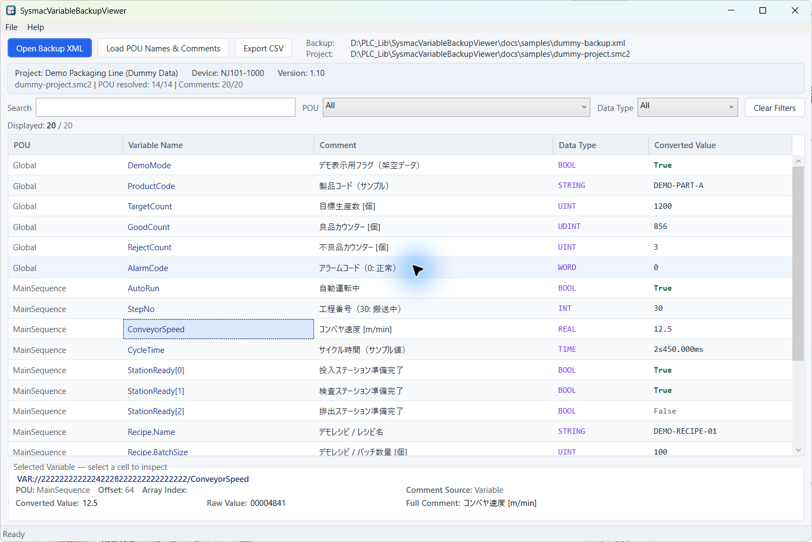

# SysmacVariableBackupViewer

[](https://github.com/fa-yoshinobu/SysmacVariableBackupViewer/releases/latest)
[](https://github.com/fa-yoshinobu/SysmacVariableBackupViewer/actions/workflows/ci.yml)
[](LICENSE)
[](https://dotnet.microsoft.com/download/dotnet/10.0)


[English](#english) | [日本語](#japanese)



---

## English

### Overview

SysmacVariableBackupViewer is a Windows desktop application for viewing and analyzing Sysmac Studio XML backup files. It provides a user-friendly interface to display variable data with advanced filtering and export capabilities.

### Key Features

- **XML Backup File Parsing**: Load and parse Sysmac Studio XML backup files
- **Variable Data Display**: View variable information in a structured table format
- **Data Type Conversion**: Automatic conversion of various PLC data types (hex, date/time, floating point, etc.)
- **Advanced Filtering**: Real-time text search and data type filtering
- **CSV Export**: Export filtered data to CSV format
- **High Performance**: Optimized for large datasets with caching and virtualization
- **About Window**: Display application information, system details, and license information

### Supported Data Types

- **Basic Types**: BOOL, WORD, UINT, INT
- **Floating Point**: REAL, LREAL
- **String Types**: STRING
- **Date/Time**: DATE_AND_TIME, TIME, DATE, TIME_OF_DAY

### System Requirements

- Windows 10 or later
- No additional runtime required for the released single-file EXE
- Minimum 4GB RAM recommended
- 100MB free disk space

### Usage

1. **Launch Application**: Run `SysmacVariableBackupViewer.exe`
2. **Open Backup XML**: Click "Open Backup XML" button and select XML backup file
3. **View Data**: Variable information is displayed in the main table
4. **Filter Data**: Use text search and data type filters
5. **Export**: Click "Export CSV" to save filtered data
6. **About**: Access Help menu → About for application information

### POU names and variable comments

After loading a backup XML, select **Load POU Names & Comments** and choose its Sysmac Studio project. The device tracking ID must match. Program IDs are replaced with POU names in the display; the original backup names and values are preserved. Load the project again after switching backups.

The **Comment** column shows local/global variable comments, array element comments, and available structure/FB member comments. Parent and member comments are separated by ` / `. Comments are searchable and included in CSV exports together with the POU name. Before loading a project, variable names show the original backup identifiers. Global variables display Global in the POU column; unmatched local POUs leave that column blank, with their original IDs available in the detail pane and POU filter. Missing comments remain blank. The project summary reports resolution and comment counts. Use the POU filter to select a scope. Select a cell to inspect the full comment, comment source, original identifier, raw value, offset and array index in the resizable detail pane. The status bar shows loading, matching and filtering activity. Matching IDs do not guarantee identical program revisions.

### Displayed Information

| Column | Description |
|--------|-------------|
| Variable Name | Variable name with hierarchical structure |
| Data Type | Data type |
| Value | Original value from XML |
| Converted Value | Human-readable converted value |
| Offset | Memory offset |
| Group | Group name (first part of hierarchy) |
| Array Index | Array index (for array variables) |

### Technical Specifications

- **Framework**: .NET 10.0 WPF
- **Architecture**: MVVM pattern
- **Deployment**: Single-file executable
- **Optimization**: ReadyToRun compilation, trimming enabled
- **Memory Management**: Efficient caching and garbage collection

### Build Instructions

```bash
# Run local CI checks
ci.bat

# Build single-file executable
build.bat
```

Output: `artifacts\publish\SysmacVariableBackupViewer.exe`

### License

This project is licensed under the MIT License. See [LICENSE](LICENSE).

### Author

- **Author**: fa-yoshinobu
- **GitHub**: https://github.com/fa-yoshinobu/SysmacVariableBackupViewer

---

## Japanese

### 概要


SysmacVariableBackupViewerは、Sysmac StudioのXMLバックアップファイルを表示・分析するためのWindowsデスクトップアプリケーションです。高度なフィルタリング機能とエクスポート機能を備えた、使いやすいインターフェースで変数データを表示します。

### 主な機能

- **XMLバックアップファイル解析**: Sysmac StudioのXMLバックアップファイルの読み込みと解析
- **変数データ表示**: 構造化されたテーブル形式での変数情報表示
- **データ型変換**: 各種PLCデータ型（16進数、日時、浮動小数点など）の自動変換
- **高度なフィルタリング**: リアルタイムテキスト検索とデータ型フィルタリング
- **CSVエクスポート**: フィルタリングされたデータのCSV形式での出力
- **高性能**: キャッシュと仮想化による大規模データセットの最適化
- **Aboutウィンドウ**: アプリケーション情報、システム詳細、ライセンス情報の表示

### 対応データ型

- **基本型**: BOOL, WORD, UINT, INT
- **浮動小数点**: REAL, LREAL
- **文字列型**: STRING
- **日時型**: DATE_AND_TIME, TIME, DATE, TIME_OF_DAY

### システム要件

- Windows 10以降
- 配布 EXE の実行に追加ランタイム不要
- 推奨メモリ: 4GB以上
- 空き容量: 100MB以上

### 使用方法

1. **アプリケーション起動**: `SysmacVariableBackupViewer.exe`を実行
2. **ファイル読み込み**: 「Open Backup XML」ボタンをクリックしてXMLバックアップファイルを選択
3. **データ表示**: メインテーブルに変数情報が表示されます
4. **データフィルタリング**: テキスト検索とデータ型フィルタを使用
5. **エクスポート**: 「Export CSV」をクリックしてフィルタリングされたデータを保存
6. **About**: ヘルプメニュー→Aboutでアプリケーション情報を確認

### POU 名と変数コメント

バックアップ XML を開いた後、**Load POU Names & Comments** から対応する Sysmac Studio プロジェクトを選択します。機器の Tracking ID が一致する場合に、表示上のプログラム ID を POU 名に置き換えます。元のバックアップ変数名と値は保持します。別の XML を開いた場合は、プロジェクトを再選択してください。

**Comment** 列には、ローカル・グローバル変数、配列要素、および取得できる構造体・FB メンバーのコメントを表示します。親とメンバーのコメントは ` / ` で区切ります。コメント検索と、POU 名・コメントを含む CSV 出力に対応します。プロジェクト未読込時は元の識別子を変数名に表示します。グローバル変数の POU 列は Global、未解決のローカル POU 列は空欄とし、元の ID は詳細欄と POU フィルターで確認できます。コメントがない場合は空欄を表示します。プロジェクト概要で対応件数を確認できます。POU フィルターで所属を絞り込めます。セルを選択すると、サイズ変更可能な詳細欄にコメント全文・出所、元の識別子、Raw Value、Offset、配列インデックスを表示します。ステータスバーには読み込み・照合・絞り込みの状況を英語で表示します。ID の一致はプログラムの版の一致を保証しません。

### 表示される情報

| 列名 | 説明 |
|------|------|
| Variable Name | 階層構造を含む変数名 |
| Data Type | データ型|
| Value | XMLから読み込んだ元の値 |
| Converted Value | 人間が読みやすい変換後の値 |
| Offset | メモリオフセット |
| Group | グループ名（階層の最初の部分） |
| Array Index | 配列インデックス（配列の場合） |

### 技術仕様

- **フレームワーク**: .NET 10.0 WPF
- **アーキテクチャ**: MVVMパターン
- **配布形式**: 単一ファイル実行形式
- **最適化**: ReadyToRunコンパイル、トリミング有効
- **メモリ管理**: 効率的なキャッシュとガベージコレクション

### ビルド手順

```bash
# ローカル CI チェック
ci.bat

# 単一ファイル EXE をビルド
build.bat
```

出力先: `artifacts\publish\SysmacVariableBackupViewer.exe`

### ライセンス

このプロジェクトは MIT License です。詳細は [LICENSE](LICENSE) を参照してください。

### 作者

- **作者**: fa-yoshinobu
- **GitHub**: https://github.com/fa-yoshinobu/SysmacVariableBackupViewer

## Release distribution

The fixed-name ZIP and checksum links below are available for the current release. Older releases retain their original assets.

- [Latest Windows x64 ZIP](https://github.com/fa-yoshinobu/SysmacVariableBackupViewer/releases/latest/download/SysmacVariableBackupViewer-win-x64.zip)
- [ZIP SHA-256 checksum](https://github.com/fa-yoshinobu/SysmacVariableBackupViewer/releases/latest/download/SysmacVariableBackupViewer-win-x64.zip.sha256)
- [Changelog](CHANGELOG.md) / [TODO](TODO.md)

Extract the ZIP file, then run `SysmacVariableBackupViewer.exe`.

Windows x64. The .NET runtime is included.

Release notes and VirusTotal scan messages are in English. Existing project documents may keep their current language.

Maintainers: update the English Changes section in `.github/release-notes.md` from the relevant CHANGELOG entries before releasing. The release workflow publishes the ZIP and checksum, then scans the actual published executables. Use the `Scan release with VirusTotal` workflow with a release tag to retry an incomplete scan. See the [shared release standard](https://github.com/fa-yoshinobu/release_standard).
